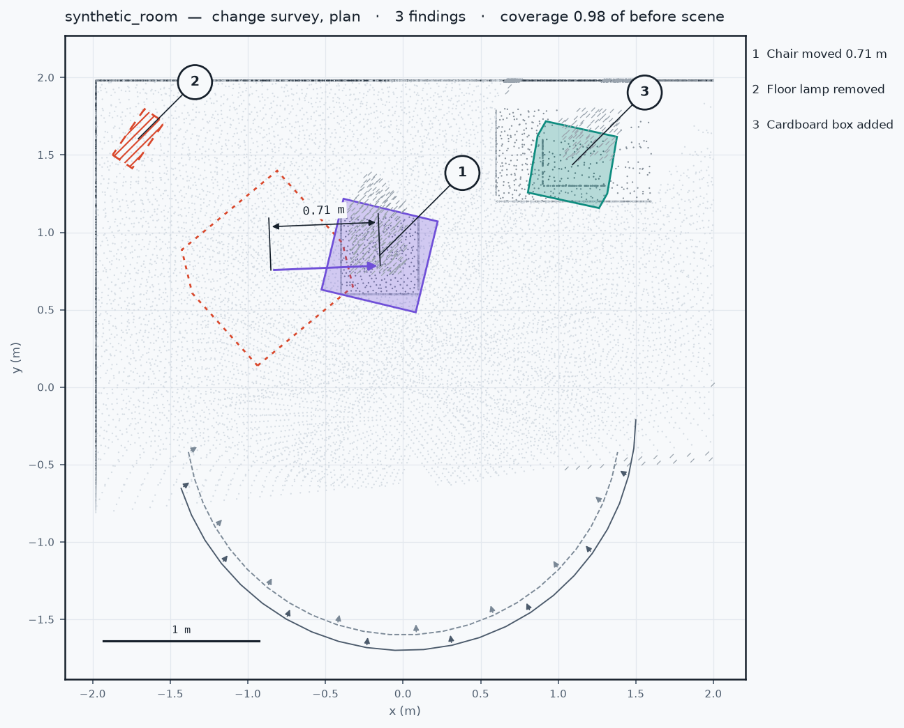
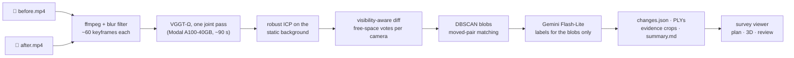

# spatiality-diff

**Two phone videos of the same room → one shared 3D scene → what was added, removed or moved, drawn on a plan with the frames that prove it.**

Successor to [spatiality_v2](https://github.com/Harrishayy/spatiality_v2) (one video → 3D + labels).

From two 20–40 second handheld captures, the pipeline runs three stages that feed one viewer:

- **Shared scene** — ffmpeg keyframes from *both* videos go through **VGGT-Ω** in **one joint forward pass** (Modal A100, ~90 s), so the two captures land in the same frame for free; robust ICP on the static background then tightens it.
- **Visibility-aware diff** — every point is projected into the *other* capture's cameras and compared with the depth seen there. Free space beyond it means removed or added; no camera ever looked there means **unobserved, which is never reported as a change**. CPU, seconds.
- **Findings** — blobs are clustered, moved pairs matched, and only the blobs are sent to a VLM for a name. Output: `changes.json` with footprints, displacements, support counts and evidence frames, plus a Next.js **change survey drawing** with accept/reject review.

&nbsp;

## Evidence

<!-- Drop the two input videos into the GitHub editor and replace the links below; keep the captions. -->
<table>
  <tr>
    <td align="center">

https://github.com/user-attachments/assets/REPLACE-WITH-BEFORE-VIDEO

<sub>Input: before capture</sub>
    </td>
    <td align="center">

https://github.com/user-attachments/assets/REPLACE-WITH-AFTER-VIDEO

<sub>Input: after capture</sub>
    </td>
  </tr>
</table>

<!-- Screen recording of the viewer: plan → select a balloon → evidence → accept. -->
<table>
  <tr>
    <td align="center">

https://github.com/user-attachments/assets/REPLACE-WITH-VIEWER-RECORDING

<sub>Output: change survey, 3D view and review</sub>
    </td>
  </tr>
</table>

<table>
    <tr>
      <td align="center"><br><sub>Plan (synthetic room): 1 chair moved 0.71 m, 2 lamp removed, 3 box added; hatched = never re-observed</sub></td>
      <td align="center"><br><sub>3D view, same balloons</sub></td>
    </tr>
    <tr>
      <td align="center"><br><sub>Detail sheet: evidence frames, measurements, accept / reject</sub></td>
      <td align="center"><br><sub>Findings strip and title block</sub></td>
    </tr>
</table>

Full runtime and cost numbers in [Runtime and cost](#runtime-and-cost) below.

&nbsp;

## Quickstart

Three paths, in order of setup cost.

### 1. Pre-baked sheet, locally (no GPU, no keys, ~3 min)

The synthetic room: two simulated sweeps with a chair moved, a lamp removed and a box added. Needs Python 3.12,
[uv](https://docs.astral.sh/uv/), [pnpm](https://pnpm.io/installation) and ffmpeg.

```bash
git clone https://github.com/Harrishayy/spatiality-diff.git && cd spatiality-diff
cd backend && uv venv --python 3.12 && uv pip install -e ".[dev]" && cd ..

PYTHONPATH=tests backend/.venv/bin/python scripts/make_demo.py     # -> outputs/synthetic_room/
cd web && pnpm install && pnpm dev                                    # -> http://localhost:3000/scenes/synthetic_room
```

### 2. Your own videos (Modal for the GPU step, recommended)

Record two sweeps of a room, 20–40 s each, phone held steady, walking a slow arc so most of the room is seen from
several angles. Move, add or remove a few objects between them. Start from a different spot the second time.

```bash
pip install modal && modal token new
cp .env.example .env                                   # GEMINI_API_KEY for labels (optional)
# Modal workspace secret `huggingface` with HF_TOKEN; VGGT-Omega weights are gated with automated approval.
(cd backend && modal deploy modal_app.py)
(cd backend && modal run modal_app.py --access)        # which checkpoints your token can download

backend/.venv/bin/spatiality-diff run --before before.mp4 --after after.mp4 --out outputs/my_room
cd web && pnpm dev                                     # -> http://localhost:3000/scenes/my_room
```

`spatiality-diff run` caches every stage: a re-run after a crash or a parameter change skips the GPU pass.

| Flag | Default | When to change it |
|---|---|---|
| `--frames-per-video` | 60 | Fewer frames = cheaper GPU pass. 40 is fine for a small room. |
| `--backend` | `vggt-omega` | `pi3x` for approximate metric scale, `vggt` for the open VGGT-1B checkpoint. |
| `--compute` | `modal` | `local` after running `scripts/run_local.py` on your own GPU or Apple MPS. |
| `--scale-m` | 0 | Metres per model unit if known; otherwise distances are in model units. |
| `--no-label` | | Skip the VLM; findings are still detected, placed and measured. |

### 3. Local GPU ⚠️ written against the same code path, not smoke-tested here

```bash
uv pip install -e "backend[gpu]"
pip install git+https://github.com/facebookresearch/vggt-omega.git   # or vggt / Pi3
python scripts/run_local.py outputs/my_room --backend vggt-omega      # after frames are extracted
backend/.venv/bin/spatiality-diff run ... --compute local
```

&nbsp;

## Example input and output

**Input.** `examples/synthetic_room/{before,after}.mp4`: two 6 s clips rendered from the synthetic room (flat colours,
so they exercise the pipeline mechanics, not the model). Real phone clips go in the same place.

**Output.** `outputs/<scene>/`:

```
changes.json            what changed, where (oriented box in the shared frame), how sure, and the evidence
summary.md              the natural-language report
before.ply, after.ply   coloured clouds in the shared frame
before_unobserved.ply   before-points the after capture never looked at (drawn hatched)
blobs/<id>_{before,after}.ply
evidence/<id>_{before,after}.jpg    best frame from each capture with the projected box drawn
cameras.json            per-frame K and cam-from-world for both captures
```

One finding in `changes.json` (from the synthetic room):

```json
{"id": "m00", "state": "moved", "label": "chair", "sentence": "Chair moved 0.71 m",
 "confidence": 0.9, "displacement_m": 0.706,
 "before": {"ply": "blobs/m00_before.ply", "centroid": [-0.95, 0.85, 0.44], "obb": {"center": [...], "extent": [...], "rotation": [...]},
            "support": {"free": 11, "looked": 12}},
 "after":  {"ply": "blobs/m00_after.ply",  "centroid": [-0.25, 0.85, 0.44], "obb": {...}, "support": {"free": 9, "looked": 10}},
 "evidence": {"before": {"frame_id": "00007", "crop": "evidence/m00_before.jpg"}, "after": {"frame_id": "00012", "crop": "evidence/m00_after.jpg"}}}
```

`support.free / support.looked` is how many frames of the other capture looked at the region and saw free space there.
`coverage` at the top of the file is the share of the before scene the after capture observed at all, so a result with
zero findings is interpretable. `python scripts/render_plan.py outputs/<scene> plan.png` draws the plan above as a PNG.

&nbsp;

## Viewer: a change survey drawing

Next.js 16 + React 19 + three.js, reading `outputs/` in place. The viewer is drawn the way a surveyor marks a site
drawing rather than as a dashboard. The primary view is a top-down **plan**: room shaded by height, both camera paths,
every finding as a numbered **callout balloon** with a footprint. Added is a solid outline with a light fill, removed is
a dashed outline with hatching where the object stood, moved is both footprints with an arrow and a **dimension line**
in metres. Points the second capture never looked at are drawn with diagonal ticks, so "not inspected" never looks like
"unchanged". A **3D** view shows the same scene with the same balloons.

Findings run along the bottom like a revision table. Selecting one opens the detail sheet: the sentence, a *why*
sentence citing the frame counts, the before and after frames, a measurements table, and **Accept / Reject**.
**Start review** steps through the findings; verdicts persist and are included in **Copy changes.json**, so a planner
consumes the reviewed result. Paper theme by day, blueprint by night.

Keys: `p` plan, `d` 3D, `b` swap base capture, `1`..`9` select, `←` `→` step, `a` accept, `r` reject, `esc` close.

&nbsp;

## Design note

### Architecture



### Design choices

One paragraph per stage; the alternatives considered and what each choice costs are in
[`docs/DESIGN_DECISIONS.md`](docs/DESIGN_DECISIONS.md), and the model survey behind them in
[`docs/RESEARCH.md`](docs/RESEARCH.md).

**One joint pass, not two reconstructions.** VGGT-family models take an unordered image set and put every frame in
the first frame's coordinate system, so feeding both captures together yields a shared frame and a shared scale with no
registration step and one GPU call. The moved objects are conflicting evidence inside the pass, which is why the next
stage re-estimates the alignment on the static background only, dropping high-residual clusters between ICP rounds.
VGGT-Ω was chosen over VGGT, Pi3X and MapAnything on viewpoint robustness and memory; Pi3X stays as the fallback and
gives approximate metric scale.

**Visibility, not nearest neighbours.** The brief's hard part is telling a real change from a viewpoint gap. A
nearest-neighbour diff between clouds reports every gap as a change. Instead each point is projected into every camera
of the other capture and compared with the depth seen at that pixel: deeper means the ray passed through free space
(vote: gone), equal means the surface is still there (vote: same), shallower means something occludes it (no evidence).
A point is a change only with enough free-space votes and few same votes; a point with no votes is unobserved and is
drawn hatched. A nearest-neighbour guard still vetoes any point with a close neighbour in the other cloud, which
protects against depth-map holes. See [`diff.py`](backend/spatiality_diff/diff.py).

**Geometry decides, language names.** Only the diff blobs go to the VLM, cropped from the frame that sees them best
with the projected box drawn on. Two to six calls per scene, under a cent. The VLM can veto a blob as not an object and
can veto a moved pairing. The whole-scene segmentation stack from v2 is deliberately absent.

**Modal for the GPU, laptop for the rest.** Only the model needs a GPU and only for about a minute. Frames, ICP, diff,
labelling and the report run on the laptop in seconds, so iteration is fast and the bill is cents.

### Tradeoffs

- **Scale.** VGGT-Ω is not metric. Distances are in model units unless `--scale-m` is given or the `pi3x` backend is
  used. The title block on every sheet states the units so the drawing never lies.
- **Depth tolerance is hand-set.** 3 cm plus 4 % of depth, chosen for feed-forward depth error. Thin objects at range
  can fall inside it and go undetected.
- **Oriented boxes on partial clouds.** A footprint is the hull of an oriented box fitted to the points that were
  actually seen, so a chair seen from one side gets a looser, rotated box than its true outline. Visible on the plan
  above as the dashed old pose of finding 1.
- **The synthetic clips prove the mechanics, not the model.** Flat-colour renders have no texture, so the model
  collapses them; the end-to-end Modal run on them completes but finds nothing. Real phone video is the real test.

### Future work

In priority order; evidence, plug-in points and costs in [`docs/UPGRADE_PLAN.md`](docs/UPGRADE_PLAN.md).

- Metric scale from MoGe-2 by a median depth-ratio fit, so every sheet is in metres.
- Hybrid registration (dense pass per capture + small joint pass + Sim(3) + static purification) as the fallback when the joint pass smears.
- Per-scene null-calibrated depth tolerance and log-odds free-space accumulation instead of fixed thresholds and vote counts.
- SAM-mask lifting for blob extents and minimum-area footprints on the plan.
- DINOv3 descriptors with ICP verification for moved-object matching, and a lighting-nuisance guard.
- PASLCD benchmark harness (mIoU and F1 against GS-Pool's 0.751).

&nbsp;

## Runtime and cost

Measured on the synthetic clips (19 keyframes per capture after the blur filter), Modal A100-40GB.

| Stage | Wall clock |
|---|---|
| Frames (ffmpeg + blur filter) | 0.2 s |
| VGGT-Ω joint pass on Modal, including model load | 90 s |
| Background ICP | 1.2 s |
| Visibility diff + clustering | 1.1 s |
| Report | 0.1 s |
| **End to end** | **92 s** |
| Modal cost per scene | a few cents |
| Gemini cost per scene | under a cent (2–6 Flash-Lite calls) |

&nbsp;

## Project structure

```
backend/spatiality_diff/
  frames.py        ffmpeg extraction, blur filter, even temporal sampling
  recon.py         model backends (vggt-omega | vggt | pi3x), joint pass, split, PLY export
  register.py      robust ICP on the static background
  diff.py          visibility-aware diff, clustering, moved matching       <- the core
  label.py         PydanticAI + Gemini: labels, pair confirmation, summary
  report.py        changes.json, summary.md, PLYs, evidence crops
  cli.py           spatiality-diff run
  modal_client.py  laptop side of the Modal call
backend/modal_app.py    the GPU function (+ check_access)
scripts/run_local.py    same model call on a local GPU / MPS
scripts/make_demo.py    synthetic scene -> outputs/synthetic_room
scripts/render_plan.py  outputs/<scene> -> plan PNG
examples/synthetic_room/  the two test clips
tests/                  synthetic room renderer + diff tests (pytest)
web/                    Next.js survey viewer
docs/                   RESEARCH.md, DESIGN_DECISIONS.md, img/
```

Tests: `PYTHONPATH=tests backend/.venv/bin/python -m pytest tests -q`. The synthetic room renders depth maps with
pinhole cameras for two sweeps with different trajectories; the diff must find exactly the moved chair, the removed lamp
and the added box, and must report a cropped second sweep as mostly unobserved rather than mostly removed.

&nbsp;

## References

1. **VGGT-Ω** — Wang et al., *VGGT-Omega*, CVPR 2026. [arXiv 2605.15195](https://arxiv.org/abs/2605.15195) ·
   [repo](https://github.com/facebookresearch/vggt-omega) · [weights](https://huggingface.co/facebook/VGGT-Omega) (gated, non-commercial).
   The joint reconstruction.
2. **VGGT** — Wang et al., CVPR 2025. [repo](https://github.com/facebookresearch/vggt). Open fallback checkpoint.
3. **π³ / Pi3X** — Wang et al., ICLR 2026. [repo](https://github.com/yyfz/Pi3). Permutation-equivariant fallback with approximate metric scale.
4. **GS-Pool** — [arXiv 2610.06688](https://arxiv.org/html/2610.06688v1). The frustum-gating rule the visibility diff follows.
5. **MV-3DCD / PASLCD** — CVPR 2025. [project](https://chumsy0725.github.io/MV-3DCD/). The evaluation target.
6. **raycloudtools** (CSIRO) — [repo](https://github.com/csiro-robotics/raycloudtools). Ray-based transient detection, the classical form of the diff.
7. **Open3D** for ICP, DBSCAN and oriented boxes; **PydanticAI** + Gemini for labels; **Modal** for the GPU.

## License

MIT. Model weights carry their own licences (VGGT-Ω and Pi3X non-commercial).
