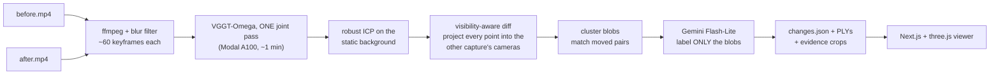

# spatiality-diff

**Two phone videos of the same room -> one shared 3D scene -> what was added, removed or moved, with the frames that prove it.**

Built for Humanoid's intern challenge *What Changed in the Room?*. Successor to
[spatiality_v2](https://github.com/Harrishayy/spatiality_v2) (single video -> 3D + labels).

## How it works



The idea that makes it work: a point from the first video is only *removed* if some camera in the second video
looked at that spot and saw free space beyond it. Points nobody re-observed are reported as **unobserved**, never as
changes. That is what separates a real change from a viewpoint gap, and it is a few numpy projections per frame.

Stages 3 to 6 run on a laptop CPU in seconds. The only GPU step is the reconstruction, and the only paid API calls
are one short VLM call per detected change. A scene costs a few cents.

## Quickstart

```bash
git clone https://github.com/Harrishayy/spatiality-diff && cd spatiality-diff
cd backend && uv venv --python 3.12 && source .venv/bin/activate && uv pip install -e ".[dev]" && cd ..

# 1. No GPU, no keys: a synthetic room with a moved chair, a removed lamp and an added box
PYTHONPATH=tests python scripts/make_demo.py
cd web && pnpm install && pnpm dev        # http://localhost:3000/scenes/synthetic_room

# 2. Your own videos (Modal for the GPU step; see .env.example for keys)
cp .env.example .env                      # GEMINI_API_KEY for labels; HF_TOKEN lives in the Modal secret `huggingface`
modal token new && (cd backend && modal deploy modal_app.py)
(cd backend && modal run modal_app.py --access)      # which weights this workspace can download
spatiality-diff run --before before.mp4 --after after.mp4 --out outputs/my_room
```

The Modal app `spatiality-diff` has two functions: `reconstruct` (the joint pass, A100-40GB, weights cached in a
volume) and `check_access` (tests the Hugging Face token against the three checkpoints without a forward pass).

`spatiality-diff run` is cached per stage: re-running after a crash or a parameter change skips the GPU pass.

### Options that matter

| Flag | Default | Why you would change it |
|---|---|---|
| `--frames-per-video` | 60 | Fewer frames = cheaper GPU pass. 40 is fine for a small room. |
| `--backend` | `vggt-omega` | `pi3x` for approximate metric scale, `vggt` for the commercial checkpoint. |
| `--compute` | `modal` | `local` after running `scripts/run_local.py` on your own GPU or Apple MPS. |
| `--scale-m` | 0 | Metres per model unit if known; otherwise distances are in model units. |
| `--no-label` | | Skip the VLM; changes are still detected and placed. |

### Local GPU instead of Modal

```bash
uv pip install -e "backend[gpu]"
pip install git+https://github.com/facebookresearch/vggt-omega.git
python scripts/run_local.py outputs/my_room --backend vggt-omega      # after frames are extracted
spatiality-diff run ... --compute local
```

`scripts/run_local.py` is written against the same `run_backend()` the Modal function uses but has not been
smoke-tested here; Modal is the path this project is built against.

## What you get

```
outputs/<scene>/
  changes.json            what changed, where (OBB in the shared frame), confidence, support counts, evidence
  summary.md              the natural-language report
  before.ply, after.ply   coloured clouds in the shared frame
  before_unobserved.ply   before-points the after capture never looked at
  blobs/<id>_{before,after}.ply
  evidence/<id>_{before,after}.jpg   best frame from each capture with the projected box drawn
  cameras.json            per-frame K and cam-from-world for both captures
```

A change in `changes.json`:

```json
{"id": "m00", "state": "moved", "label": "chair", "sentence": "Chair moved 0.71 m",
 "confidence": 0.9, "displacement_m": 0.706,
 "before": {"ply": "blobs/m00_before.ply", "centroid": [...], "obb": {...}, "support": {"free": 11, "looked": 12}},
 "after":  {"ply": "blobs/m00_after.ply",  "centroid": [...], "obb": {...}, "support": {"free": 9,  "looked": 10}},
 "evidence": {"before": {"frame_id": "00007", "crop": "evidence/m00_before.jpg"}, "after": {...}}}
```

`support.free / support.looked` is how many frames of the other capture looked at the region and saw free space
there. `coverage` at the top of the file is the share of the before scene the after capture observed at all, so a
"no changes" result is interpretable.

## Viewer: a change survey drawing

Next.js 16 + React 19 + three.js. Reads `outputs/` in place through one file route.

The viewer is drawn the way a surveyor marks a site drawing. The primary view is a top-down **plan** of the room,
shaded by height, with every finding as a numbered **callout balloon** and a footprint: added is a solid outline with a
light fill, removed is a dashed outline with hatching where the object stood, moved is both footprints with an arrow and
a **dimension line** reading the displacement in metres. Points the second capture never looked at are drawn with
diagonal ticks, so "not inspected" never looks like "unchanged". Both camera paths, a scale bar, a legend and a title
block complete the sheet. A **3D** view shows the same scene with the same balloons.

Findings run along the bottom like a revision table. Selecting one opens a detail sheet with the finding sentence, a
"why" sentence citing the frame counts, the before and after frames, a measurements table, and **Accept / Reject**.
**Start review** steps through the findings one at a time; verdicts persist in the browser and are included in
**Copy changes.json** so a planner can consume the reviewed result.

Keys: `p` plan, `d` 3D, `b` swap base capture, `1`..`9` select, `←` `→` step, `a` accept, `r` reject, `u` toggle
unobserved, `c` toggle cameras, `esc` close. Paper theme by day, blueprint by night.

## Project structure

```
backend/spatiality_diff/
  frames.py        ffmpeg extraction, blur filter, even temporal sampling
  recon.py         model backends (vggt-omega | vggt | pi3x), joint pass, split, PLY export
  register.py      robust ICP on the static background
  diff.py          visibility-aware diff, clustering, moved matching       <- the core
  label.py         PydanticAI + Gemini: labels, pair confirmation, summary
  report.py        changes.json, summary.md, PLYs, evidence crops
  cli.py           spatiality-diff run
  modal_client.py  laptop side of the Modal call
backend/modal_app.py   the GPU function
scripts/run_local.py   same model call on a local GPU / MPS
scripts/make_demo.py   synthetic scene -> outputs/synthetic_room
tests/                 synthetic room renderer + diff tests (pytest)
web/                   Next.js viewer
docs/RESEARCH.md       model and method survey (Oct 2026)
docs/DESIGN_DECISIONS.md
```

## Tests

```bash
PYTHONPATH=tests backend/.venv/bin/python -m pytest tests -q
```

The synthetic room renders depth maps with pinhole cameras for two sweeps with different trajectories. The diff
must find exactly the moved chair, the removed lamp and the added box, and must report a cropped second sweep as
mostly unobserved rather than mostly removed.

## Status

- [x] Visibility-aware diff, clustering, moved matching: tested on the synthetic room
- [x] Viewer: builds, renders the synthetic scene
- [x] Modal app deployed; VGGT-Omega, VGGT-1B and Pi3X weights all download with the workspace token
- [x] End-to-end run on Modal (synthetic test videos in `examples/synthetic_room/`)
- [ ] First run on real phone videos
- [ ] Metric scale estimate from floor-to-ceiling height
- [ ] Evaluation on PASLCD indoor scenes

## References

See [docs/RESEARCH.md](docs/RESEARCH.md) for the full survey with links and licences. Key ones:
VGGT-Ω (arXiv 2605.15195), Pi3X (arXiv 2507.13347), MapAnything (arXiv 2509.13414), GS-Pool (arXiv 2610.06688),
MV-3DCD / PASLCD (CVPR 2025), raycloudtools (CSIRO).
